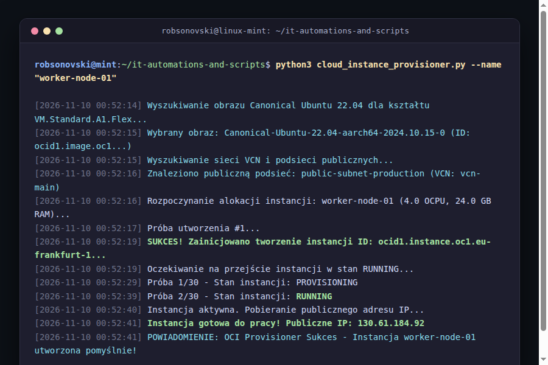
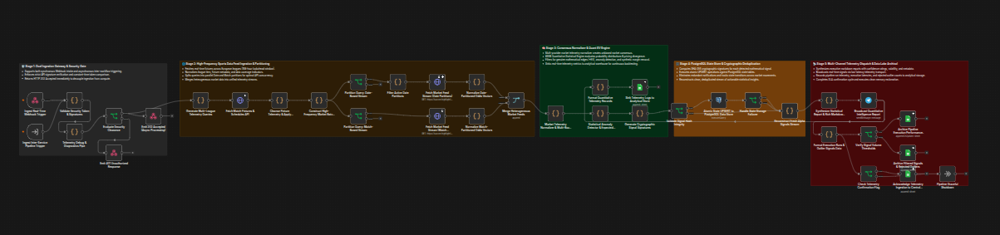
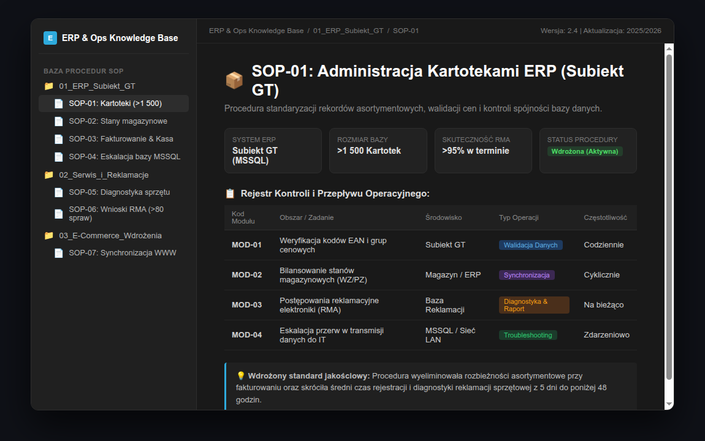

# 🛠 IT Automations & Production Scripts

[](https://www.python.org/)
[](https://n8n.io/)
[](https://www.oracle.com/cloud/)
[](https://linuxmint.com/)

Zbiór skryptów automatyzacyjnych, produkcyjnych pipeline'ów orkiestracji (n8n) oraz narzędzi infrastrukturalnych przygotowanych pod kątem niezawodności, eliminacji powtarzalnych zadań i monitoringu procesów w czasie rzeczywistym.

---

## 📁 Zawartość repozytorium

### 1. `cloud_instance_provisioner.py` (Python 3 + OCI SDK)
Autonomiczne narzędzie CLI do automatyzacji wdrożeń i provisioningu maszyn wirtualnych w chmurze Oracle Cloud Infrastructure (OCI):
* **Dynamiczny discovery zasobów:** automatycznie przeszukuje i mapuje dostępne wirtualne sieci chmurowe (VCN) oraz filtruje publiczne podsieci bez blokady IP (`prohibit_public_ip_on_vnic`).
* **Wyszukiwanie obrazów OS:** pobiera najnowszy stabilny obraz Canonical Ubuntu 22.04 LTS dedykowany dla architektury ARM (`aarch64` / VM.Standard.A1.Flex).
* **Odporność na "Out of host capacity":** implementuje mechanizm retry loop z konfigurowalnym interwałem czasowym, co pozwala na bezobsługowe oczekiwanie na zwolnienie zasobów w danym Availability Domain.
* **Weryfikacja cyklu życia:** odpytuje API o stan instancji (`lifecycle_state == 'RUNNING'`), weryfikuje przypisanie karty sieciowej (VNIC) i ekstrahuje publiczny adres IPv4.
* **Integracja z systemem hosta:** wysyła desktopowe powiadomienia w środowisku Linux (`notify-send`) z informacją o powodzeniu operacji.

#### Uruchomienie i log z wykonania:
```bash
# Instalacja zależności
pip install -r requirements.txt

# Sprawdzenie parametrów CLI
python cloud_instance_provisioner.py --help

# Uruchomienie z domyślną konfiguracją OCI (~/.oci/config)
python cloud_instance_provisioner.py --name "worker-node-01" --ocpus 4 --memory-in-gbs 24
```



---

### 2. Architektura Potoków n8n & Szablon `n8n_error_alerting_workflow.json`
Złożony ekosystem 6 zintegrowanych scenariuszy n8n (>100 węzłów) łączący REST API, bazy PostgreSQL, arkusze Google Sheets i komunikator Telegram:

* **Scenariusz #2 („Analityk” - widoczny na zrzucie poniżej):** Centralny potok przetwarzania danych (37 węzłów):
  * **Bezpieczeństwo & ACK:** Weryfikacja nagłówków autoryzacyjnych (`Auth OK?` / `Respond 401`) oraz natychmiastowa asynchroniczna odpowiedź `HTTP 202 Response (ACK)` chroniąca przed timeoutami webhooków.
  * **Pobieranie & Transformacja:** Odpytywanie zewnętrznych REST API (`HL Matches`, `HL Odds`) z paginacją oraz normalizacja struktur obiektów JSON w JavaScript (`Code Nodes`).
  * **Baza PostgreSQL:** Dynamiczne zapobieganie duplikatom poprzez węzeł deduplikacji i zapytania `UPSERT` w relacyjnej bazie PostgreSQL.
  * **Multi-Sink:** Jednoczesna synchronizacja telemetrii z arkuszami Google Sheets oraz formatowanie i dystrybucja alertów na Telegramie.
* **Scenariusz #3 (`n8n_error_alerting_workflow.json` - dołączony plik JSON):** Globalny Error Handler:
  * Przechwytuje wyjątki z dowolnego aktywnego potoku za pomocą węzła `Error Trigger`.
  * Formatuje payload błędu (nazwa węzła, timestamp `Europe/Warsaw`, stack trace, link do egzekucji) i wysyła natychmiastowe ostrzeżenie do administratora.



#### Import szablonu obsługi błędów do instancji n8n:
1. W panelu n8n wybierz: **Workflows** ➔ **Import from File**.
2. Wskaż dołączony plik `n8n_error_alerting_workflow.json`.
3. Skonfiguruj własny identyfikator czatu (`CHAT_ID`) i token bota Telegram.

---

### 3. ERP (Subiekt GT), Wsparcie Operacyjne & Baza Wiedzy SOP
* **Administracja ERP:** Nadzór nad bazą ponad **1 500 kartotek asortymentowych i kontrahentów** w systemie Subiekt GT (MSSQL), weryfikacja poprawności fakturowania, synchronizacja stanów magazynowych (WZ/PZ).
* **Standaryzacja procesów (SOP):** Wdrożenie cyfrowej bazy wiedzy i procedur wykonawczych w Notion (diagnostyka i ponad 80 rozpatrzonych reklamacji sprzętu ze wskaźnikiem terminowości >95%, procedury eskalacji incydentów do centralnego IT).



---

## 🛠 Stack technologiczny
* **Języki i narzędzia:** Python 3, Bash, JavaScript (Code Nodes w n8n), SQL, Git
* **Integracje:** n8n, REST API, Webhooks (asynchroniczne potwierdzenia ACK 202)
* **Infrastruktura & Chmura:** Linux Mint / Ubuntu, Oracle Cloud Infrastructure (OCI), VirtualBox
* **Systemy operacyjne & ERP:** Subiekt GT (utrzymanie baz danych, procedury SOP w Notion)

---

## 👤 Autor
**Robert Kazienko**  
* Inżynier | Automatyzacja Procesów | IT Support & Wdrożenia
* 📍 Przemyśl, Polska
* ✉ [mr.robkaz@gmail.com](mailto:mr.robkaz@gmail.com)
* 💼 [LinkedIn](https://linkedin.com/in/robert-kazienko)
* 🐙 [GitHub](https://github.com/robsonovski)
